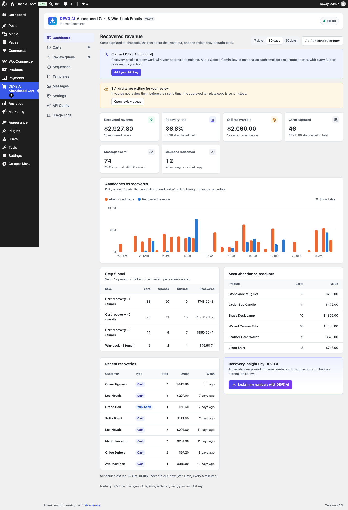

# DEV3 AI Abandoned Cart & Win-back Emails for WooCommerce

Capture abandoned carts, send AI-personalised recovery and win-back emails and SMS, and track recovered revenue.



## Features

DEV3 AI Abandoned Cart & Win-back Emails captures carts on the classic and block checkout (GDPR-consent aware), runs multi-step email and SMS sequences with unique coupons and one-click cart restore links, and shows exactly how much revenue came back.

With your own Google AI API key, DEV3 AI personalises each reminder for the shopper's cart. Every AI draft waits in a review queue until you approve it, unless you turn on auto-approve for that template. Without a key everything works on your approved templates.

### Features
* Cart capture: classic checkout, block checkout (Store API + fields), logged-in customers, "Save my cart" block and shortcode.
* Consent modes: notice, opt-in checkbox, none. Separate SMS opt-in. Unsubscribe link and List-Unsubscribe headers in every email.
* Sequences: cart recovery and win-back, up to 10 steps each, email or SMS, per-step delays, minimum cart value.
* Templates: subject, preheader, heading, body, button, merge tags, live preview, test sends, quality checks, approval workflow.
* Unique single-use coupons per step (percent, fixed, free shipping), locked to the shopper's email, auto-cleanup.
* Recovery links restore items, quantities and variations and apply the coupon.
* Send-time tuning: moves sends to the shopper's best hour, outside quiet hours in their own timezone.
* Recovered-revenue dashboard: KPIs, abandoned vs recovered chart, step funnel, top abandoned products, recent recoveries.
* SMS through any Twilio-compatible API.
* HPOS and Cart/Checkout blocks compatible. Personal data exporter/eraser and retention cleanup.

### DEV3 AI features (Google AI)
* Per-cart personalised copy, reviewed in the Review queue (or auto-approved per template).
* Write templates with DEV3 AI, including subject-line ideas.
* Build my sequence with DEV3 AI from your store's recovery numbers.
* Send-time insights from your open/click/order hours.
* Recovery insights: a plain-language read of your dashboard.

### Privacy
Only the shopper's first name and cart products are sent to Google AI for personalised copy; emails and phone numbers are never sent. See docs/index.html for the full privacy notes.

## Requirements

- WordPress 6.0 or newer (tested up to 6.8)
- PHP 7.4 or newer
- WooCommerce 8.0 or newer (required)
- Optional: your own Google AI API key (from Google AI Studio) to switch on the DEV3 AI features. The rest of the plugin works without one.

## Installation

### From the release zip

1. Download `dev3-ai-abandoned-cart-for-woocommerce.zip` from the [latest release](https://github.com/dev3tech/dev3-ai-abandoned-cart-for-woocommerce/releases/latest).
2. In WordPress, go to **Plugins → Add New → Upload Plugin**, choose the zip and click **Install Now**.
3. Click **Activate**.

### Build from source

```bash
git clone https://github.com/dev3tech/dev3-ai-abandoned-cart-for-woocommerce.git
cd dev3-ai-abandoned-cart-for-woocommerce
composer install --no-dev
npm ci
npm run build
```

Then copy the `dev3-ai-abandoned-cart-for-woocommerce` folder into `wp-content/plugins/` and activate it.

### Getting started

1. Upload the plugin zip in Plugins → Add New → Upload and activate it (WooCommerce must be active).
2. Open DEV3 AI Abandoned Cart → Settings to choose the consent mode and sending rules.
3. Optional: add your Google AI API key under API Config.

## FAQ

### Will AI-written emails go out without my approval?
No. AI drafts wait in the Review queue. If one is not reviewed by its send time, the approved template copy is sent instead (or held, if you choose). Only templates with auto-approve on send AI copy without review.

### Does it work with the block checkout?
Yes. Capture uses the Store API and the consent checkbox uses WooCommerce's additional checkout fields.

### Do I need a Google AI key?
No. All recovery features work with your templates. The key adds personalisation and the AI assistants.

## Documentation

The full HTML guide (installation, settings, hooks and FAQ) is in [`docs/index.html`](docs/index.html). Open it in a browser after cloning or downloading the repository.

## Changelog

### 1.0.0
* Initial release.

## Licence

Released under the GNU General Public License v2.0 or later (GPL-2.0-or-later). See [LICENSE](LICENSE).

## More from DEV3

- [DEV3 AI Abandoned Cart & Win-back Emails for WooCommerce on the DEV3 Marketplace](https://www.dev3.tech/item/dev3-ai-abandoned-cart-for-woocommerce)
- [More WordPress plugins, themes and templates from DEV3](https://www.dev3.tech/marketplace)
